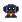
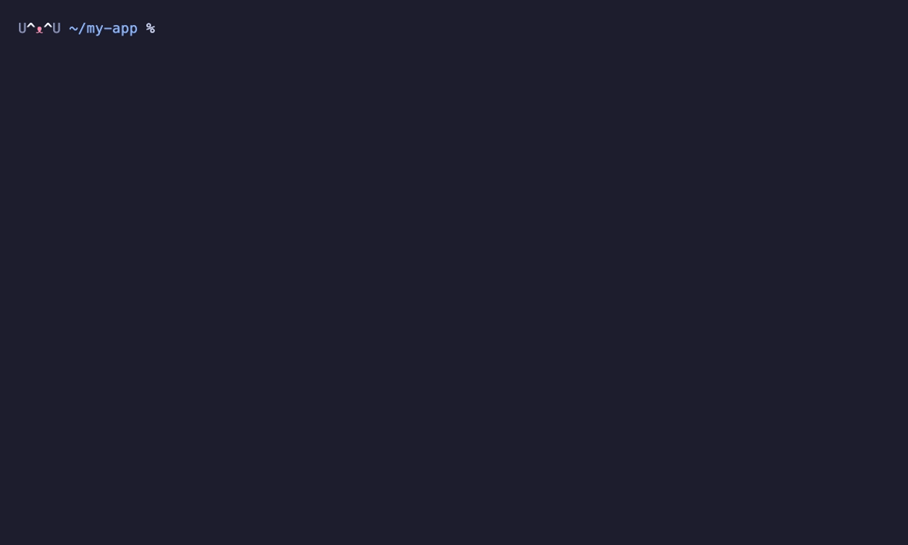
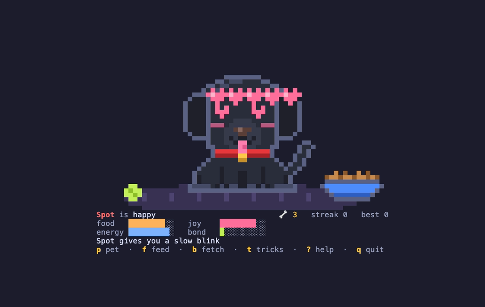
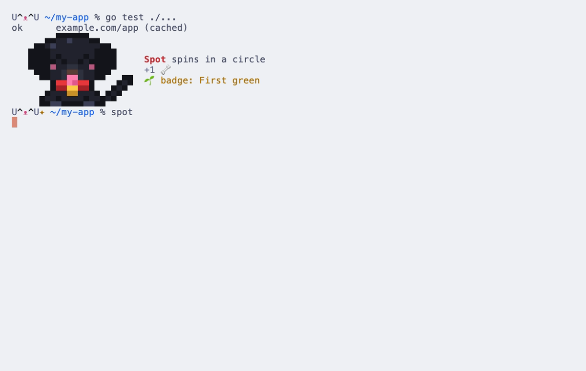
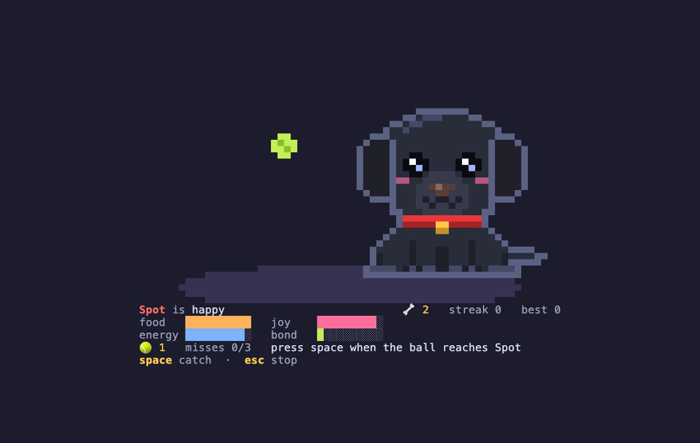

<div align="center">



# spot

**A black labrador who lives in your terminal. He gets hungry, and he wags when your tests pass.**

[Install](#install) · [Set up](#set-up) · [What Spot does](#what-spot-does) · [Commands](#commands) · [Config](#config) · [Web page](https://gitguy268.github.io/spot-cli/)

[](https://github.com/Gitguy268/spot-cli/actions/workflows/ci.yml)
[](https://github.com/Gitguy268/spot-cli/releases)
[](go.mod)
[](LICENSE)



</div>

Spot sits in your prompt as a tiny `U^ᴥ^U`. Run your tests and he reacts for about a second, right there in your shell: a wag and a treat when they pass, his head on your knee when they fail, and zoomies across the screen when you fix a broken run. Then he waits quietly in your scrollback.

Run `spot` to visit his room, where you can pet him, feed him, play fetch and ask for tricks. He gets hungry and a bit sleepy over the day, but he never dies and never guilt-trips you.

Spot is a real dog, a black lab with a red collar. This one is drawn in pixel art with half-block characters, and has a light rim so a black dog doesn't vanish into a black terminal.

<div align="center">


</div>

## Install

| | |
| --- | --- |
| Homebrew (macOS, Linux) | `brew install gitguy268/tap/spot-cli` (new Homebrew asks for `brew trust gitguy268/tap` once first) |
| Go 1.25+ | `go install github.com/Gitguy268/spot-cli/cmd/spot@latest` |
| Binaries | macOS, Linux and Windows on the [releases page](https://github.com/Gitguy268/spot-cli/releases/latest) |
| From source | `git clone https://github.com/Gitguy268/spot-cli && cd spot-cli && go build -o spot ./cmd/spot` |

It's one binary, with no daemon and no network access. Spot's memory is one small JSON file.

## Set up

Add one line to your shell config, after your theme or prompt tool, and open a new terminal:

| Shell | Line | File |
| --- | --- | --- |
| zsh | `eval "$(spot init zsh --prompt)"` | `~/.zshrc` |
| bash | `eval "$(spot init bash --prompt)"` | `~/.bashrc` |
| fish | `spot init fish --prompt \| source` | `~/.config/fish/config.fish` |
| PowerShell | `Invoke-Expression (& spot init pwsh --prompt \| Out-String)` | `$PROFILE` |

`spot init` only prints the hook. It never edits your files. `--prompt` puts Spot's face in front of your prompt. Leave it out to place the face yourself: it's in `$SPOT_FACE`.

<details>
<summary>Starship, Powerlevel10k and other prompt tools</summary>

Prompt tools draw their own colours, so give them the plain face: set `prompt = "emoji"` (🐶✨) or `prompt = "ascii"` (`U^w^U*`) in the [config](#config), and use `spot init zsh` without `--prompt`.

**Starship:** add `export SPOT_FACE` after the `eval` line in `~/.zshrc`, and this to `~/.config/starship.toml`:

```toml
[env_var.SPOT_FACE]
format = "$env_value "
```

**Powerlevel10k:** add a segment in `~/.p10k.zsh`:

```zsh
function prompt_spot() { p10k segment -t "$SPOT_FACE" }
typeset -g POWERLEVEL9K_LEFT_PROMPT_ELEMENTS=(spot "${POWERLEVEL9K_LEFT_PROMPT_ELEMENTS[@]}")
```

</details>

**No hooks?** Wrap a command instead: `spot run -- go test ./...`. It passes the output through untouched, keeps the exit code (so it's safe in scripts and `make`), and prints nothing extra when it isn't on a terminal.

## What Spot does

**He notices test runs.** The hook knows about 75 test commands, among them `go test`, `npm test`, `pnpm test`, `bun test`, `vitest`, `jest`, `pytest`, `cargo test`, `cargo nextest`, `make test`, `rspec`, `mix test`, `dotnet test`, `swift test`, `deno test`, `zig build test` and `./gradlew test`. Run `spot tests` for the full list, and add your own in the config. Leading settings like `BREAK=1` and wrappers like `sudo` or `time` are skipped, and a test inside a chain like `cd api && go test ./...` counts too. Ctrl-C and "command not found" don't count as a failure.

**He reacts.**

| Your tests | Spot |
| --- | --- |
| pass | wags, +1 🦴 treat, the streak goes up |
| fail | sad ears and a kind word; the streak resets, nothing else is lost |
| pass after failing (the same command) | zoomies across the terminal, +2 🦴 |

**He lives on real time.** Food, joy, energy and bond change as the hours pass, worked out from timestamps whenever spot runs. There's no background process. Food runs low after about 8 hours. At night he sleeps, unless you're still running tests. When he's hungry, `spot feed` uses a treat, and a free bowl of kibble is there every 4 hours, so he's never stuck hungry.

**He learns.** Pass streaks and bond teach him tricks: high five (streak 3), speak (bond 30), roll over (streak 10), spin (streak 25) and play sleepy (bond 60). There are twelve badges to earn together, from 🌱 First green and 🔁 Comeback pup to 🦉 Night owl and 🎾 Fetch champ.

<details>
<summary>Spot's room</summary>

`spot` opens his room. Keys: <kbd>p</kbd> pet (or click him), <kbd>f</kbd> feed, <kbd>b</kbd> fetch, <kbd>t</kbd> tricks, <kbd>?</kbd> help, <kbd>q</kbd> quit.

- **Fetch:** the ball arcs over to Spot. Press <kbd>space</kbd> as it reaches his mouth. Each catch makes the next throw faster, and three misses end the round. If you're early it bonks his nose, and if you're late he chases it down and brings it back.
- **Live:** keep the room open in a split pane and Spot reacts there to tests you run in other terminals.
- **Night:** after 23:00 the moon comes out, and if nothing's going on he sleeps under a blanket.
- Terminals smaller than 66×23 get a compact room with little Spot and his stats.



</details>

## Commands

| Command | What it does |
| --- | --- |
| `spot` | Spot's room |
| `spot run -- CMD` | Run a command with Spot watching. `-q` skips the reaction |
| `spot init SHELL [--prompt]` | Print the shell hook: `zsh`, `bash`, `fish`, `pwsh` |
| `spot status [--json]` | How he's doing |
| `spot feed` · `spot pet` | A treat (or kibble), an ear scratch |
| `spot tricks` · `spot trick NAME` | What he knows, and a trick played inline |
| `spot badges` · `spot stats` | Badges, test history, pass rate and his diary |
| `spot rename NAME` | He answers to anything said kindly |
| `spot reset [--yes]` | Start over with a new puppy (asks first) |
| `spot config [init]` | Show the config and state paths, or write an example config |
| `spot tests` | The commands Spot treats as tests |
| `spot show [ANIM] [SECONDS]` | Play any of his animations |

## Config

Everything is optional. `spot config init` writes a commented example to `~/.config/spot/config.toml`:

```toml
reactions = "full"     # "full" (a one-second animation), "short" (one line) or "off"
theme = "auto"         # "auto", "dark" or "light"
prompt = "face"        # "face" (coloured U^ᴥ^U), "emoji" (🐶✨) or "ascii" (U^w^U)
extra_test_commands = ["./scripts/test.sh", "task test*"]   # * matches the rest of a word
ignore_commands = ["go test -run XXX"]
# test_commands = [...]  replaces the built-in list
```

| Variable | Effect |
| --- | --- |
| `SPOT_QUIET=1` | No reactions; Spot still keeps count |
| `SPOT_REDUCED_MOTION=1` | One-line reactions instead of animations |
| `NO_COLOR`, `TERM=dumb` | Spot as a silhouette, eyes and all |
| `SPOT_HOME`, `SPOT_CONFIG` | Where the state and config live |

State lives in `$XDG_STATE_HOME/spot` (usually `~/.local/state/spot`, `%LOCALAPPDATA%\spot` on Windows), and the config in `$XDG_CONFIG_HOME/spot` (`%APPDATA%\spot` on Windows).

<details>
<summary>Limits and things worth knowing</summary>

- **Typing during a reaction is safe.** spot never reads your keyboard while Spot animates, so typed-ahead commands aren't swallowed. That's also why a key press can't skip a reaction. It lasts about a second, and `reactions = "short"` or `SPOT_QUIET=1` make it shorter or remove it.
- **Prompt cost:** the hook starts `spot` once per prompt, which takes a few milliseconds and makes no network or disk writes unless a test just ran.
- **Tested in:** zsh 5.9, bash 3.2 and 5 (also with `HISTCONTROL=ignoreboth`), and fish, driven through a real pseudo-terminal in CI and on macOS, plus the recorded VHS sessions in zsh. PowerShell is tested only in CI on Windows, macOS and Linux runners, and those checks load the hook and run the prompt but can't replay an interactive history. Nobody has used it on a Windows machine yet, so reports are very welcome.
- **Comebacks** match on the command with settings like `BREAK=1` removed, so `go test ./pkg` failing and then `go test ./...` passing isn't a comeback.
- Two shells finishing at the same moment take turns through a lock file. A corrupt state file is set aside as `state.json.bad-…`, and Spot starts over as a puppy instead of crashing your prompt.
- Builds from a git checkout print `dev` for `spot version`, and so do the rolling `latest` builds. Tagged releases, Homebrew and `go install …@v0.1.0` print the version.

</details>

## Contributing

Bug reports, new test runners, tricks and drawings are all welcome: see [CONTRIBUTING.md](CONTRIBUTING.md). It covers building, the checks, and how Spot's pixel art works (it's a grid of letters, and there's a preview tool). Please report security issues privately as described in [SECURITY.md](SECURITY.md). Everyone taking part follows the [Code of Conduct](CODE_OF_CONDUCT.md).

## License

[MIT](LICENSE), © 2026 Lucas Van De Weerd. Third-party notices are in [NOTICE](NOTICE). The pictures in `docs/` were recorded with [VHS](https://github.com/charmbracelet/vhs) from the tapes in `docs/tapes`.
